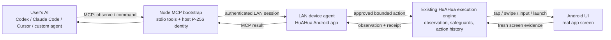
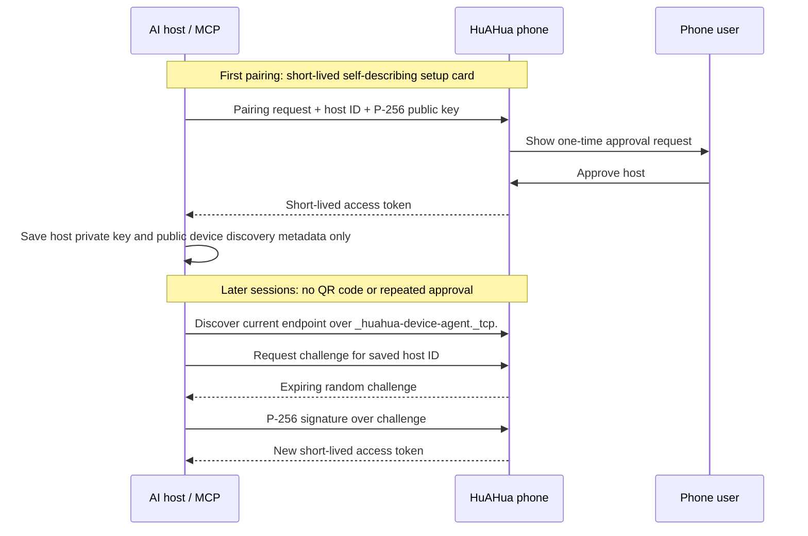

# HuAHua Device Runtime

[English](README.md) | [简体中文](README.zh-CN.md)

Local-network-first runtime for letting a user's AI safely control a device on
which the HuAHua app is installed.

This repository intentionally contains no model provider integration, cloud
control plane, user test assets, or API keys. It is split into portable
protocol contracts, platform runtimes, and thin platform Agent Apps.

## Modules

- `contracts`: Kotlin/JVM portable device command and receipt contract.
- `android-runtime`: Android implementation boundary for self-device control.
- `samples/android-pairing-shell`: non-production Android sample for protocol
  experiments. It is not a second HuAHua app and users must not install it.
- `mcp-bootstrap`: Node.js MCP bridge used by an AI host on the same LAN.

## Platform scope

The production runtime currently targets Android. `contracts` defines the
platform-neutral command, receipt, and pairing types without Android API
dependencies; iOS and desktop runtimes can implement the same protocol.

## Architecture

HuAHua follows the same separation that makes device tools useful to coding
agents: the user's AI remains the **brain**; this runtime supplies only the
phone's **eyes, hands, trust boundary, and evidence**. It does not decide what
to tap, infer task completion, or call any model provider.

### Component responsibilities

| Component | Responsibility | Explicitly not responsible for |
| --- | --- | --- |
| User AI | Interprets the task, chooses the next tool call, evaluates the result. | Device pairing, direct Android privileges, hidden HuAHua reasoning. |
| `mcp-bootstrap` | Provides stdio MCP tools, owns the computer's P-256 identity, finds an approved phone on the LAN, and obtains a short-lived session. | Persisting access tokens, deciding screen actions, bypassing phone approval. |
| HuAHua Device Agent | Hosts the LAN API, enforces pairing and session authorization, creates fresh observations, and rejects stale actions. | Cloud remote control, arbitrary Shell/ADB access, permanent bearer tokens. |
| HuAHua execution engine | Reuses the app's existing observation, action safety, human-handoff, floating stop control, and local action-history paths. | A second external-only automation implementation. |
| `contracts` / `android-runtime` | Keep commands, receipts, pairing primitives, and Android-specific execution adapters reusable and testable. | Product UI, model credentials, user cloud data. |

### Observe → act → verify loop

Every action is grounded in the latest observation rather than in a stale
coordinate or a cached screenshot:

1. The AI calls `device_observe` and receives the current image, foreground
   app, screen dimensions, capture time, and an opaque `observation_id`.
2. The AI chooses one bounded action and sends that exact `observation_id`
   with a short user-visible step summary.
3. The phone rejects the action if the id is missing or no longer current.
4. The existing HuAHua engine performs the permitted action, preserves its
   normal safety/handoff behavior, records a receipt locally, and captures a
   fresh observation when possible.
5. The AI uses the receipt and fresh observation to decide whether to continue
   or finish. A successful tap alone is never treated as task completion.

This mirrors the useful part of `agent-device`'s model: semantic screen state
and fresh evidence keep an AI grounded, while the agent itself retains control
of planning and verification. HuAHua differs in that the physical Android
phone runs the agent service locally on the same LAN; no USB debugging bridge
or desktop companion application is required for normal use.

## AI host connection

HuAHua has two equivalent sharing entries for a phone's first AI-host pairing:

- **Copy for AI** is the reliable entry. It copies a self-describing text card
  containing the setup documentation URL, the MCP package name, and a
  short-lived connection card.
- **QR code** encodes the same text card for a person to scan and forward. An
  AI may be able to read a QR image, but QR image recognition is not a protocol
  requirement; users should paste the decoded text into an AI when possible.

The text card tells a new AI what it is receiving before it sees the private
connection card. It points to the public setup guide in
[`mcp-bootstrap/README.md`](mcp-bootstrap/README.md). The card must not be put
in a GitHub query parameter, browser URL, issue, commit, or log: it is a
short-lived pairing secret.

The first pairing requires a one-time approval on the phone. The Node MCP host
then saves only its local P-256 host key and public device discovery metadata
under `~/.config/huahua-mcp` with user-only permissions. Future connections
discover the phone over mDNS and obtain a new short-lived signed session; they
do not need another QR code or approval unless the user revokes the host,
clears app data, or uses another computer.

### Trust and session protocol

The connection card is only a bootstrap secret. It is never a long-lived
credential, and neither the MCP host nor the phone persists a bearer token or
fixed LAN endpoint. Revoking a host, clearing HuAHua data, or moving to a
different computer intentionally requires a new first pairing.

## Runtime boundary

This repository is the HuAHua Device Agent runtime. It does not host a cloud
control plane, user test assets, model API keys, raw ADB endpoints, or
arbitrary shell execution. The LAN MCP bridge is deliberately limited to an
approved host, fresh observations, and narrow phone actions; it is not a shell
or an unauthenticated remote-control endpoint.

HuAHua consumes `:android-runtime` through a Gradle composite build during
local development. The HuAHua foreground/UI service owns lifecycle,
permissions, and execution presentation. `AndroidPrivilegedDeviceRuntime`
provides fixed Android actions and two-phase raw PNG capture. Its public API is
limited to typed device commands and screenshot capture; it exposes neither a
general-purpose command interface nor product UI.

`samples/android-pairing-shell` exists only as a tiny Android integration
example for runtime contributors. Production users install HuAHua; the HuAHua
app owns pairing, QR/self-describing setup cards, permissions, LAN service,
and the execution UI.
