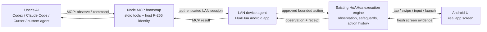
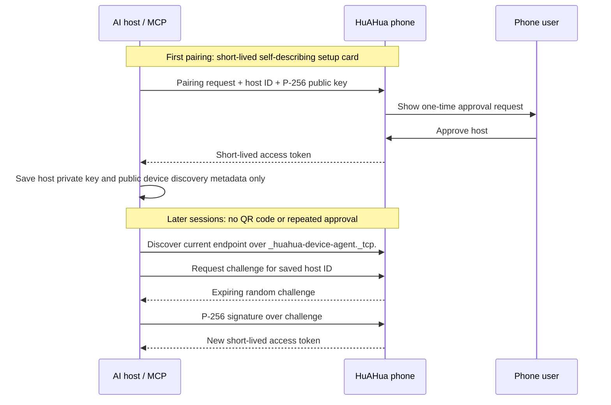

# HuAHua Device Runtime

[English](README.md) | [简体中文](README.zh-CN.md)

Local-network-first runtime for letting a user's AI safely control a device on
which the HuAHua app is installed.

This repository contains the device-runtime layer only: portable protocol
contracts, platform runtimes, and thin platform Agent Apps. Model-provider
integration, cloud control-plane services, user test assets, and API keys are
outside this repository's scope.

## Get HuAHua

Install the HuAHua Android app from the [official HuAHua website](https://huahua.sidhu.net.cn/).

The AI host requires **Node.js 20 or newer**. The standard Node.js installer
includes both `npm` and `npx`; no separate ADB, Android Studio, Java, Python,
Git, Docker, USB connection, or desktop companion is required for normal use.
The phone and AI host must be able to reach each other on the same local
network.

Verify the host environment before pairing:

```bash
node --version
npm --version
npx --version
npx --yes @newwe/huahua@latest prepare
```

## Modules

- `contracts`: Kotlin/JVM portable device command and receipt contract.
- `android-runtime`: Android implementation boundary for self-device control.
- `mcp-bootstrap`: Node.js MCP bridge used by an AI host on the same LAN.

## Platform scope

The production runtime currently targets Android. `contracts` defines the
platform-neutral command, receipt, and pairing types without Android API
dependencies; iOS and desktop runtimes can implement the same protocol.

## Architecture

The architecture separates AI task policy from device I/O. The user's AI
interprets the task, selects tool calls, and evaluates completion. This runtime
provides device observation, bounded actions, authorization, and execution
evidence; it does not contain task-planning logic or model-provider calls.



### Component responsibilities

| Component | Responsibility | Explicitly not responsible for |
| --- | --- | --- |
| User AI | Interprets the task, chooses the next tool call, evaluates the result. | Device pairing, direct Android privileges, hidden HuAHua reasoning. |
| `mcp-bootstrap` | Provides stdio MCP tools, owns the computer's P-256 identity, finds an approved phone on the LAN, and obtains a short-lived session. | Persisting access tokens, deciding screen actions, bypassing phone approval. |
| HuAHua Device Agent | Hosts the LAN API, enforces pairing and session authorization, creates fresh observations, and rejects stale actions. | Cloud remote control, arbitrary Shell/ADB access, permanent bearer tokens. |
| HuAHua execution engine | Reuses the app's existing observation, action safety, human-handoff, floating stop control, and local action-history paths. | A second external-only automation implementation. |
| `contracts` / `android-runtime` | Keep commands, receipts, pairing primitives, and Android-specific execution adapters reusable and testable. | Product UI, model credentials, user cloud data. |

### Observe → act → verify loop

Every action is grounded in the latest observation rather than in a stale
coordinate or a cached screenshot:

1. The AI calls `device_task_start` once and copies the user's complete original
   phone-control request into `original_user_command` for the phone's local history.
2. The AI calls `device_observe` and receives the current image, foreground
   app, screen dimensions, capture time, and an opaque `observation_id`.
3. The AI chooses one bounded action and sends that exact `observation_id`
   with a short user-visible step summary.
4. The phone rejects the action if the id is missing or no longer current.
5. The existing HuAHua engine performs the permitted action, preserves its
   normal safety/handoff behavior, records a receipt locally, and captures a
   fresh observation when possible.
6. The AI uses the receipt and fresh observation to decide whether to continue
   or finish. A successful tap alone is never treated as task completion.

Semantic screen state and fresh evidence keep the AI grounded on the physical
device while planning and verification remain on the AI host. The Android phone
runs the device service on the local network; normal operation does not require
a USB debugging bridge or a desktop companion application.

## AI host connection

HuAHua has two equivalent sharing entries for a phone's first AI-host pairing:

- **Copy for AI** is the reliable entry. It copies a self-describing text card
  containing the setup documentation URL, the MCP package name, and a
  short-lived connection card.
- **QR code** encodes the same text card for scan-and-forward workflows. The
  decoded text card is the normative setup input; QR recognition is a
  convenience transport.

The text card tells a new AI what it is receiving before it sees the private
connection card. It points to the public setup guide in
[`mcp-bootstrap/README.md`](mcp-bootstrap/README.md). The card must not be put
in a GitHub query parameter, browser URL, issue, commit, or log: it is a
short-lived pairing secret.

The first pairing requires a one-time approval on the phone. The Node MCP host
saves its local P-256 host key and public device-discovery metadata under
`~/.config/huahua-mcp` with user-only permissions. Subsequent connections use
mDNS discovery and a newly signed short-lived session. Re-pairing is required
when the host is revoked, app data is cleared, or a different computer is used.

### Persistent MCP startup vs direct CLI

When the user asks to connect or start MCP, or expects the phone to remain
online, the AI host must prepare the package and start the MCP server with:

```bash
npx --yes @newwe/huahua@<published-version> prepare
npm exec --yes @newwe/huahua@<published-version> connect '<connection_card>'
```

`connect` performs the first pairing and then continues as the same stdio MCP
process, keeping the phone heartbeat alive. Do not substitute the one-shot
`pair` command for `connect`.

`pair`, `status`, `observe`, and `command` belong to the direct CLI mode for AI
hosts that cannot configure MCP. Each command exits after its single operation.
After `pair` returns a `device_id`, the phone may show the computer as
disconnected until another CLI command establishes a short-lived session. This
is expected direct-CLI behavior and must not be described as an active MCP
connection.

### Trust and session protocol



The connection card is an ephemeral bootstrap credential. Neither endpoint
persists a bearer token or a fixed LAN endpoint. Host revocation, HuAHua data
clearance, and host migration invalidate the pairing and require re-pairing.

## Runtime boundary

This repository implements the HuAHua Device Agent runtime. Its scope excludes
cloud control-plane services, user test assets, model API keys, raw ADB
endpoints, and arbitrary command execution. The LAN MCP bridge exposes a
verified device-operation surface for an approved host, fresh observations, and
bounded phone actions.

HuAHua consumes `:android-runtime` through a Gradle composite build during
local development. The HuAHua foreground/UI service owns lifecycle,
permissions, and execution presentation. `AndroidPrivilegedDeviceRuntime`
provides fixed Android actions and two-phase raw PNG capture. Its public API is
limited to typed device commands and screenshot capture; it exposes neither a
general-purpose command interface nor product UI.

HuAHua is the production application and owns pairing, QR/self-describing
setup cards, permissions, LAN service, and execution UI.
