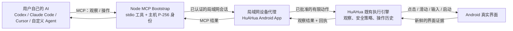
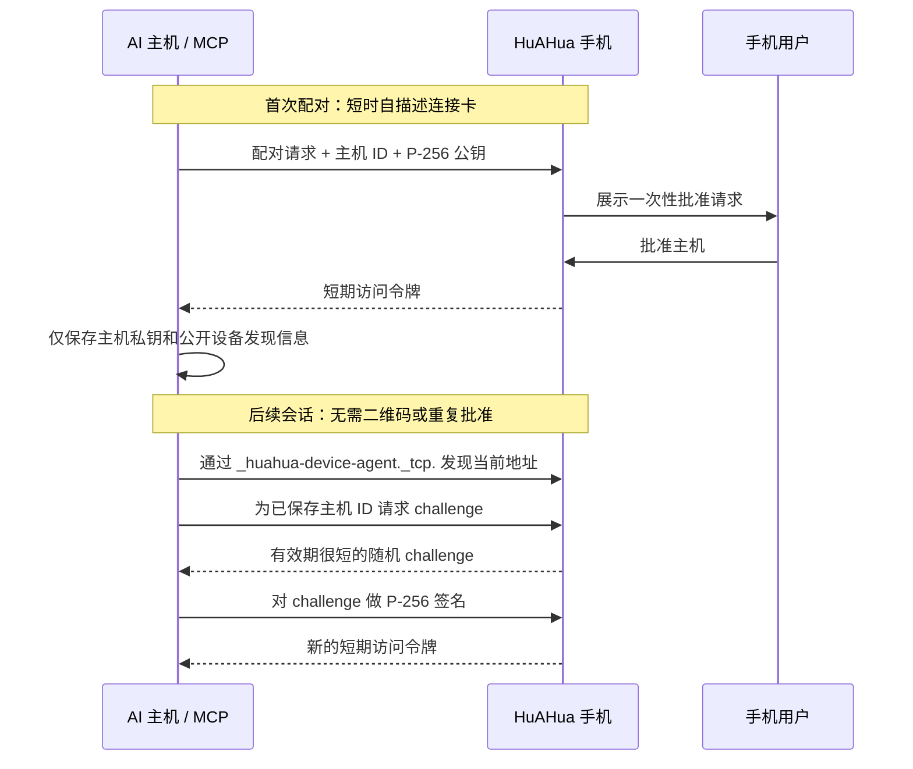

# HuAHua Device Runtime

[English](README.md) | [简体中文](README.zh-CN.md)

面向局域网优先场景的设备运行时：让用户自己的 AI 安全操控已安装 HuAHua 的手机。

本仓库仅包含设备运行时层：可移植协议契约、平台运行时和轻量平台 Agent 应用。模型服务商
集成、云端控制平面、真实用户测试资产和 API Key 不属于本仓库范围。

## 获取 HuAHua

请从 [HuAHua 官方网站](https://huahua.sidhu.net.cn/)安装 Android App。

AI 所在电脑需要安装 **Node.js 20 或更高版本**。Node.js 标准安装包已包含 `npm` 和
`npx`；正常使用不需要另行安装 ADB、Android Studio、Java、Python、Git、Docker、电脑
客户端，也不需要使用数据线。手机与 AI 所在电脑需要处于可互相访问的同一局域网。

首次配对前可通过以下命令检查并准备电脑环境：

```bash
node --version
npm --version
npx --version
npx --yes @newwe/huahua@latest prepare
```

## 模块

- `contracts`：Kotlin/JVM 可移植的设备命令与回执契约。
- `android-runtime`：Android 自机操控的实现边界。
- `mcp-bootstrap`：同一局域网内供 AI 主机使用的 Node.js MCP 桥接包。

## 平台范围

当前生产运行时面向 Android。`contracts` 定义了不依赖 Android API 的跨平台命令、回执与配对
类型；iOS 和桌面运行时可实现同一套协议。

## 技术架构

架构将 AI 的任务决策与设备 I/O 分离：用户自己的 AI 负责理解任务、选择工具调用和评估完成
状态；本运行时提供设备观察、有限动作、授权和执行证据，不包含任务规划逻辑或模型服务调用。



### 组件职责

| 组件 | 负责什么 | 明确不负责什么 |
| --- | --- | --- |
| 用户 AI | 理解任务、选择下一次工具调用、判断结果是否满足任务。 | 设备配对、直接 Android 权限、HuAHua 的隐藏推理。 |
| `mcp-bootstrap` | 提供 stdio MCP 工具，保存电脑的 P-256 身份，在局域网发现已批准手机并获取短期会话。 | 保存访问令牌、决定屏幕动作、绕过手机批准。 |
| HuAHua Device Agent | 托管 LAN API，执行配对与会话授权，生成新鲜观察并拒绝陈旧动作。 | 云端远控、任意 Shell/ADB、永久 Bearer Token。 |
| HuAHua 执行引擎 | 复用 App 既有的观察、动作安全、人工接管、悬浮停止与本地操作历史。 | 另一套仅供外部 AI 的自动化实现。 |
| `contracts` / `android-runtime` | 保持命令、回执、配对原语和 Android 执行适配器的可复用与可测试。 | 产品 UI、模型凭据、用户云端数据。 |

### 观察 → 操作 → 验证闭环

每一次操作都必须基于最新观察，而不是旧坐标或缓存截图：

1. AI 调用一次 `device_task_start`，把用户要求控制手机的原始命令完整传给手机，用于
   创建本地聊天会话。
2. AI 调用 `device_observe`，获取当前图像、前台 App、屏幕尺寸、采集时间和不透明的
   `observation_id`。
3. AI 选择一个有限动作，并携带完全相同的 `observation_id` 与简短的用户可见步骤说明。
4. 如果 id 缺失或不再是当前页面，手机会拒绝该动作。
5. HuAHua 既有执行引擎执行被允许的动作，保留原有安全/接管行为、本地回执记录，并尽量
   获取新的观察。
6. AI 用回执和新的观察决定继续还是完成；一次成功点击本身从不代表任务完成。

语义化屏幕状态和新鲜证据使 AI 的判断始终对应真实设备，规划和验证则留在 AI 主机。Android
手机在同一局域网内运行设备服务；正常使用不依赖 USB 调试桥或桌面客户端。

## AI 主机连接

HuAHua 为手机首次连接 AI 主机提供两个等价的分享入口：

- **复制给 AI** 是可靠入口。它复制一份自描述文字卡，其中包含安装文档地址、MCP 包名和
  短时连接卡。
- **二维码** 编码同一份自描述文字卡，适用于扫码转发。解码后的文字卡是规范的接入输入；
  二维码识别仅作为便捷传输方式。

这份文字卡会先告诉陌生 AI 它收到的内容是什么，再提供私密连接卡。完整接入说明见
[`mcp-bootstrap/README.md`](mcp-bootstrap/README.md)。连接卡不能放进 GitHub query、浏览器
URL、Issue、提交记录或日志中；它是短时有效的配对密钥。

首次配对需要用户在手机上批准一次。Node MCP 主机在 `~/.config/huahua-mcp` 中保存本机
P-256 主机密钥和公开的设备发现元数据，并以仅当前用户可访问的权限保存。后续连接通过 mDNS
发现手机并建立新的短期签名会话。撤销主机、清空 App 数据或更换电脑后，需要重新配对。

### 信任与会话协议



连接卡是短时有效的启动配对凭据。MCP 主机和手机均不持久化 Bearer Token 或固定局域网
地址。撤销主机、清空 HuAHua 数据或更换电脑会使配对失效，需重新配对。

## 运行时边界

本仓库实现 HuAHua Device Agent 运行时。其范围不包含云端控制平面、用户测试资产、模型 API
Key、原始 ADB 端点或任意命令执行。LAN MCP 桥接为已批准主机提供经校验的设备操作面，
并以最新观察和有限手机动作作为约束。

HuAHua 在本地开发时通过 Gradle composite build 消费 `:android-runtime`。HuAHua 的前台/UI
服务负责生命周期、权限和执行呈现；`AndroidPrivilegedDeviceRuntime` 提供固定 Android
动作及两阶段原始 PNG 截图。运行时公开 API 仅包含类型受约束的设备命令和截图采集，
不提供通用命令执行接口或产品 UI。

HuAHua 是生产应用，负责配对、二维码/自描述卡、权限、LAN 服务和执行 UI。
