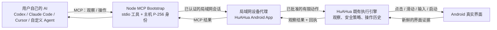
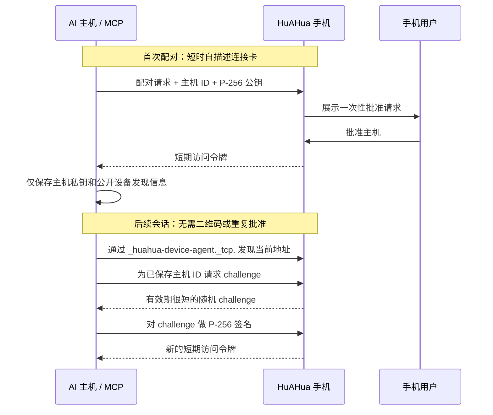

# HuAHua Device Runtime

[English](README.md) | [简体中文](README.zh-CN.md)

面向局域网优先场景的设备运行时：让用户自己的 AI 安全操控已安装 HuAHua 的手机。

本仓库不包含模型服务商集成、云端控制平面、真实用户测试资产或 API Key。代码分为可移植
协议契约、平台运行时和轻量平台示例。

## 模块

- `contracts`：Kotlin/JVM 可移植的设备命令与回执契约。
- `android-runtime`：Android 自机操控的实现边界。
- `samples/android-pairing-shell`：仅用于协议实验的非生产 Android 示例；它不是第二个
  HuAHua App，用户无需安装。
- `mcp-bootstrap`：同一局域网内供 AI 主机使用的 Node.js MCP 桥接包。

第一阶段以 Android 为主；`contracts` 不依赖 Android API，后续 iOS 与桌面适配器可以复用
同一套协议。

## 技术架构

HuAHua 遵循设备工具与 AI 主脑的职责分离：用户自己的 AI 仍然是**大脑**；本运行时只提供
手机的**眼睛、手、信任边界和证据**。它不决定点击什么、不自行判断任务完成、也不调用任何
模型服务商。

### 组件职责

| 组件 | 负责什么 | 明确不负责什么 |
| --- | --- | --- |
| 用户 AI | 理解任务、选择下一次工具调用、判断结果是否满足任务。 | 设备配对、直接 Android 权限、HuAHua 的隐藏推理。 |
| `mcp-bootstrap` | 提供 stdio MCP 工具，保存电脑的 P-256 身份，在局域网发现已批准手机并获取短期会话。 | 保存访问令牌、决定屏幕动作、绕过手机批准。 |
| HuAHua Device Agent | 托管 LAN API，执行配对与会话授权，生成新鲜观察并拒绝陈旧动作。 | 云端远控、任意 Shell/ADB、永久 Bearer Token。 |
| HuAHua 执行引擎 | 复用 App 既有的观察、动作安全、人工接管、悬浮停止与本地操作历史。 | 另一套仅供外部 AI 的自动化实现。 |
| `contracts` / `android-runtime` | 保持命令、回执、配对原语和 Android 执行适配器的可复用与可测试。 | 产品 UI、模型凭据、用户云端数据。 |

### 观察 → 操作 → 验证闭环

每一次操作都必须基于最新观察，而不是旧坐标或缓存截图：

1. AI 调用 `device_observe`，获取当前图像、前台 App、屏幕尺寸、采集时间和不透明的
   `observation_id`。
2. AI 选择一个有限动作，并携带完全相同的 `observation_id` 与简短的用户可见步骤说明。
3. 如果 id 缺失或不再是当前页面，手机会拒绝该动作。
4. HuAHua 既有执行引擎执行被允许的动作，保留原有安全/接管行为、本地回执记录，并尽量
   获取新的观察。
5. AI 用回执和新的观察决定继续还是完成；一次成功点击本身从不代表任务完成。

这与 `agent-device` 有价值的模型一致：语义化屏幕状态和新鲜证据让 AI 保持对真实设备的
约束，而 Agent 自己仍掌握规划和验证。HuAHua 的区别是物理 Android 手机在同一局域网内
运行设备服务；正常使用不需要 USB 调试桥或桌面客户端。

## AI 主机连接

HuAHua 为手机首次连接 AI 主机提供两个等价的分享入口：

- **复制给 AI** 是可靠入口。它复制一份自描述文字卡，其中包含安装文档地址、MCP 包名和
  短时连接卡。
- **二维码** 编码同一份自描述文字卡，便于人扫码后转发。AI 可能可以识别二维码图片，
  但图片识别不是协议前提；条件允许时应将解码文字粘贴给 AI。

这份文字卡会先告诉陌生 AI 它收到的内容是什么，再提供私密连接卡。完整接入说明见
[`mcp-bootstrap/README.md`](mcp-bootstrap/README.md)。连接卡不能放进 GitHub query、浏览器
URL、Issue、提交记录或日志中；它是短时有效的配对密钥。

首次配对需要用户在手机上批准一次。之后 Node MCP 主机只在
`~/.config/huahua-mcp` 中保存本机 P-256 主机密钥和公开的设备发现元数据。后续连接通过
mDNS 找到手机并换取新的短期签名会话；除非用户撤销主机、清空 App 数据或更换电脑，否则
不需要新的二维码或重复批准。

### 信任与会话协议

连接卡只是启动配对的密钥，并非长期凭据。MCP 主机和手机都不会持久化 Bearer Token 或固定
局域网地址。撤销主机、清空 HuAHua 数据或换电脑会有意让信任链失效，此时才需要重新首次配对。

## 运行时边界

本仓库是 HuAHua Device Agent 运行时。它不托管云端控制平面、用户测试资产、模型 API Key、
原始 ADB 端点或任意 Shell 执行。LAN MCP 桥接严格限制为已批准主机、最新观察和有限手机动作；
它不是 Shell，也不是无需认证的远控端点。

HuAHua 在本地开发时通过 Gradle composite build 消费 `:android-runtime`。HuAHua 的前台/UI
服务仍然是宿主，其固定 Android 动作和两阶段原始 PNG 截图委托给
`AndroidPrivilegedDeviceRuntime`。原始 Shell 始终留在运行时内部；这不会引入
任意 Shell 访问，也不会引入第二个产品 App。

`samples/android-pairing-shell` 只是给运行时贡献者使用的小型 Android 集成示例。生产用户
安装 HuAHua；HuAHua App 负责配对、二维码/自描述卡、权限、LAN 服务和执行 UI。
