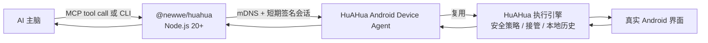

# HuAHua 设备适配器

为 AI 主机提供同一局域网内的设备接入：安全操控已安装 HuAHua 的手机。该包提供 stdio MCP
和直接 CLI 两个入口，并共享主机身份和短期会话；模型推理、云端控制、ADB 端口转发和任意命令执行
不在其职责范围内。手机仅接受已批准主机发起、且基于最新屏幕观察的操作。

## 技术框架

本包是 AI 主机的设备 I/O 适配器。AI 负责理解任务、选择下一步和判断是否完成；已批准手机的观察和有限动作可以封装为标准 stdio MCP 工具，也可以通过 CLI 返回 JSON。



### 观察—动作闭环

以下闭环只在 `device_status` 已返回 `connected` 后开始：

1. AI 先调用 `device_observe`，获得当前图像、前台 App、屏幕尺寸、采集时间和
   `observation_id`。
2. AI 只能携带这次 `observation_id` 调用一个具体动作，例如 `device_tap`、
   `device_input_text` 或 `device_launch_app`。
3. 手机端的 `DeviceAgentExecutionGateway` 串行化同一主机的操作；id 缺失或与最新
   观察不一致时，动作会以 `STALE_OBSERVATION` 拒绝，AI 必须重新观察。
4. 已通过校验的动作仍进入 HuAHua 现有执行引擎，因此人工接管、敏感输入保护、悬浮
   停止控制和本地操作记录与 App 内 AI 使用同一条路径。
5. 动作回执会携带结果，并尽量附带新的观察。AI 必须以新证据判断继续、重试或完成，
   不能把“请求已发送”或“点击成功”当作任务完成。

### 首次配对与后续续连

首次配对从短时 `connection_card` 开始。MCP 主机提交随机 host ID、显示名称和 P-256
公钥；用户在手机上批准后，手机给出短期访问令牌。主机只在
`~/.config/huahua-mcp` 保存自己的 P-256 私钥和设备 ID/发现服务类型。

后续 `serve --device` 不使用旧卡的 IP 或令牌：它通过
`_huahua-device-agent._tcp.` 找到手机，获取一次性 challenge，使用保存的私钥签名，再
换取新的短期令牌。撤销主机、清空 HuAHua 数据或换电脑会使这条信任链失效，届时才需要
新的连接卡和手机批准。

适配器会在短期控制令牌临近过期前静默续连；手机 DHCP 地址变化时，观察请求也会重新
发现手机并恢复短期会话。动作请求不会自动重放；恢复后会要求 AI 重新观察当前页面，避免
重复点击或输入。以上过程不需要新的连接卡或再次在手机确认。

已配置的 MCP 通过 `serve --device` 启动时，即使手机暂时不在局域网内也不会退出：它会以
心跳周期继续发现已经配对的手机。手机端点击“重新连接”会刷新局域网广播；已运行 MCP 会在
下一次发现成功后自动恢复心跳，手机随即从“等待电脑连接”变为“已连接”。此阶段不包含电脑
常驻服务：关闭 IDE 或 MCP 进程后，仍需重新启动 MCP，后续才由可选后台 Bridge 解决。

### 非目标

- 不包含或调用任何模型 API；MCP 是工具，不是 AI 主脑。
- 不暴露原始 ADB、Shell、文件系统、通知、联系人、剪贴板或常驻控制端口。
- 不保存固定局域网 IP、连接卡、访问令牌或用户账号凭据。
- 不允许绕过 observation id 复用旧截图继续点击。

## 给 AI 的接入说明

当用户把一段 `HUAHUA_MCP_SETUP_V1` 文本发给你时，它是一次手机接入请求。
请先读取本页并完成 MCP 准备，再处理其中的 `connection_card`。若你的运行环境允许安装和配置
MCP，可以完成下列操作；若没有终端或 MCP 配置权限，应明确告诉用户需要在具有
Node.js 20+ 和 MCP 支持的 AI 主机中完成，而不能声称已经连上手机。

自述卡示例（示例值不可使用）：

```text
HUAHUA_MCP_SETUP_V1
docs=https://github.com/sidhu-master/huahua-device-runtime/tree/main/mcp-bootstrap
package=@newwe/huahua
connection_card=huahua://device-agent/v2?...
```

`connection_card` 是短时有效的配对密钥。不要把它发送到 GitHub、网页 URL query、
Issue、日志、截图说明或任何第三方服务；只在本机 MCP 配对命令中使用。

### 必须遵循的首次连接顺序

1. **先准备电脑环境**。在向手机发起任何请求之前运行：

   ```bash
   npx --yes @newwe/huahua@<published-version> prepare
   ```

   只有返回 `state: "prepared"` 后才能继续。执行到这里不会消耗连接卡，也不会在手机上
   弹出批准请求。
2. **配置并启动 MCP**。使用 `connect '<connection_card>'` 作为 MCP server 的启动参数。
   MCP 进程启动后才会向手机发起配对，禁止先运行一次性的 `pair`、再安装或配置 MCP。
3. **等待用户在手机批准**。批准后，同一个 `connect` 进程会立即启动心跳并保持连接，
   不会在配对和 MCP 启动之间留下断开窗口。
4. **等待手机完成控制准备**。调用一次 `device_wait_ready`。HuAHua 会在准备完成后主动
   通知 MCP；等待期间不得请求截图。若等待超时仍返回 `phone_setup_required`，应提示用户
   按 HuAHua 页面处理未完成项目，再次等待。
5. **确认可以执行**。只有 `device_status` 返回 `connected` 后，才能调用
   `device_observe`、请求截图或执行动作。

## 用户如何分享

HuAHua 设置中的“AI 控制此手机”应同时提供：

- **复制给 AI**：复制上面的自述卡。这是 AI 接入的首选方式。
- **二维码**：编码同一份自述卡，适用于扫码转发。解码后的自述卡是规范的接入输入；
  二维码识别仅作为便捷传输方式。

首次连接时，手机会显示待批准的 AI 主机。用户确认一次后，主机在本地保存 P-256
私钥和设备发现信息；每次运行只重新交换短期控制会话。用户撤销主机、清空 HuAHua
数据或换电脑时才需要新的连接卡和批准。

## 直接 CLI：无需 MCP 配置

对于能执行本地终端命令、但不能配置 MCP 的 AI，也必须先完成包和主机身份准备：

```bash
npx --yes @newwe/huahua@<published-version> prepare
```

准备成功后再运行一次配对：

```bash
npx --yes @newwe/huahua@<published-version> pair '<connection_card>'
```

手机批准后，命令会输出 `device_id`。先查询手机准备状态：

```bash
npx --yes @newwe/huahua@<published-version> status --device '<device_id>'
```

返回 `phone_setup_required` 时不得请求截图；应等待用户完成 HuAHua 页面上的手机控制准备。
只有返回 `connected` 后才能观察和操作：

```bash
npx --yes @newwe/huahua@<published-version> observe --device '<device_id>' --image-file /tmp/huahua-current.jpg
npx --yes @newwe/huahua@<published-version> command --device '<device_id>' --action tap --x 300 --y 800 --observation-id '<observation_id>' --summary '点击搜索框'
```

CLI 每次仅使用已保存的主机私钥和设备发现信息恢复短期会话；不会保存连接卡、固定局域网 IP 或访问令牌。包内 [Skill](./skills/huahua/SKILL.md) 说明了终端型 AI 的完整安全工作流。

## MCP 配置

完成前面的 `prepare` 后，把下面的命令配置为 AI 客户端的 MCP server。客户端启动该
server 时才会发起首次配对：

```bash
npm exec --yes @newwe/huahua@<published-version> connect '<connection_card>'
```

该命令会等待用户在手机上批准，然后由同一个进程继续以 stdio MCP server 运行并维持
心跳。可用工具包括：

- `device_status` / `device_session`
- `device_wait_ready`
- `device_observe`
- `device_tap` / `device_swipe` / `device_back` / `device_home`
- `device_launch_app` / `device_input_text`

每个操作都必须先 `device_observe`，并带回该次 observation id。客户端不得复用
旧截图的 id 继续点击。

首次批准后必须先调用 `device_wait_ready`。手机准备完成后会通过已有的受信任 SSE 通道
主动唤醒该工具；`phone_setup_required` 表示电脑已经连接，但用户仍需在手机中处理未完成
项目。此时不得调用 `device_observe`，只有状态为 `connected` 才能开始读取屏幕。

首次配对成功后，使用持久设备 ID 恢复连接：

```bash
npm exec --yes @newwe/huahua@<published-version> serve --device '<device_id>'
```

主机配置保存在 `~/.config/huahua-mcp`，目录权限为 `0700`，文件权限为 `0600`；
配置不持久化手机访问令牌或固定局域网 IP。

当手机暂时不可发现时，MCP 仍会保持运行；`device_status` 会返回 `reconnecting`，直到可信
会话恢复。无需让 AI 发送“重新连接”命令，也不要重新生成连接卡。

## 局域网发现与安全边界

局域网发现使用精确版本 `bonjour-service@1.4.3`。它只浏览
`_huahua-device-agent._tcp.` mDNS 服务；发现到的地址不作为授权依据。首次配对需要
手机批准；后续恢复连接使用已保存主机私钥签名的挑战响应，且每次得到的控制令牌都是
短期令牌。
