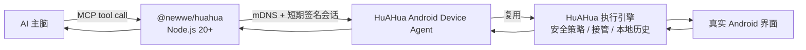

# HuAHua 设备适配器

为 AI 主机提供同一局域网内的设备接入：安全操控已安装 HuAHua 的手机。该包提供 stdio MCP
入口，负责主机身份和短期会话；模型推理、云端控制、ADB 端口转发和任意命令执行不在其职责
范围内。手机仅接受已批准主机发起、且基于最新屏幕观察的操作。

## 使用前准备

- 在手机上安装 [HuAHua App](https://huahua.sidhu.net.cn/)。
- 在 AI 所在电脑安装 **Node.js 20 或更高版本**；`npm` 与 `npx` 随 Node.js 一同安装。
- 确保手机和电脑处于可互相访问的同一局域网。
- AI 需要支持 MCP，或者具备执行本地终端命令的能力。

正常使用不需要安装 ADB、Android Studio、Java、Python、Git、Docker、独立电脑客户端，
也不需要连接数据线。首次连接前运行：

```bash
node --version
npm --version
npx --version
npx --yes @newwe/huahua@latest prepare
```

Node.js 版本应为 `v20` 或更高，最后一条命令应返回 `state: "prepared"`。

## 技术框架

本包是 AI 主机的设备 I/O 适配器。AI 负责理解任务、选择下一步和判断是否完成；已批准手机
的观察和有限动作封装为标准 stdio MCP 工具。



### 观察—动作闭环

以下闭环只在 `device_status` 已返回 `connected` 后开始：

1. AI 先调用一次 `device_task_start`，把用户要求控制手机的原始命令完整、原样传入
   `original_user_command`。手机以它创建本地聊天会话，不得用执行计划或第一步动作代替。
2. `device_task_start` 正常情况下会直接返回首个语义快照或语义增量、前台 App、采集时间和
   `observation_id`；仅当回执明确要求时才补充调用 `device_observe`。语义行和当前 ref
   由 Android 端唯一生成，Node MCP 不会再次压缩、过滤或输出原始 `ui_tree`。
3. AI 只能携带当前 `observation_id` 调用一个具体动作，例如 `device_tap`、
   `device_input_text` 或 `device_launch_app`。
4. 手机端的 `DeviceAgentExecutionGateway` 串行化同一主机的操作；id 缺失或与最新
   观察不一致时，动作会以 `STALE_OBSERVATION` 拒绝，AI 必须重新观察。
5. 已通过校验的动作仍进入 HuAHua 现有执行引擎，因此人工接管、敏感输入保护、悬浮
   停止控制和本地操作记录与 App 内 AI 使用同一条路径。
6. 动作回执会携带结果，并尽量附带新的观察。该观察就是下一步的当前证据，AI 应直接
   复用其中的新 `observation_id`，不得再重复调用 `device_observe`。只有回执缺少观察、
   明确返回 `reobserve_required`、恢复连接或用户暂停补充指令后，才重新观察。

截图是视觉证据，不是默认控制载荷。只有语义树不可用、界面为自绘、布局含义不明确或需要
视觉验证时，才调用 `device_observe_visual`；它请求并返回一张当前图像。语义观察若包含
`visual_fallback_required`，会同时给出原因并明确提示调用该工具。

### 首次配对与后续续连

首次配对从短时 `connection_card` 开始。MCP 主机提交随机 host ID、显示名称和 P-256
公钥；用户在手机上批准后，手机给出短期访问令牌。主机只在
`~/.config/huahua-mcp` 保存自己的 P-256 私钥和设备 ID/发现服务类型。

后续 `serve --device` 不使用旧卡的 IP 或令牌：它通过
`_huahua-device-agent._tcp.` 找到手机，获取一次性 challenge，使用保存的私钥签名，再
换取新的短期令牌。撤销主机、清空 HuAHua 数据或换电脑会使这条信任链失效，届时才需要
新的连接卡和手机批准。

适配器会在短期控制令牌临近过期前静默续连；手机 DHCP 地址变化时，观察请求也会重新
发现手机并恢复短期会话。动作请求不会自动重放；恢复后会要求 AI 重新观察当前页面，避免
重复点击或输入。以上过程不需要新的连接卡或再次在手机确认。

已配置的 MCP 通过 `serve --device` 启动时，即使手机暂时不在局域网内也不会退出：它会以
心跳周期继续发现已经配对的手机。手机端点击“重新连接”会刷新局域网广播；已运行 MCP 会在
下一次发现成功后自动恢复心跳，手机随即从“等待电脑连接”变为“已连接”。此阶段不包含电脑
常驻服务：关闭 IDE 或 MCP 进程后，仍需重新启动 MCP，后续才由可选后台 Bridge 解决。

### 非目标

- 不包含或调用任何模型 API；MCP 是工具，不是 AI 主脑。
- 不暴露原始 ADB、Shell、文件系统、通知、联系人、剪贴板或常驻控制端口。
- 不保存固定局域网 IP、连接卡、访问令牌或用户账号凭据。
- 不允许绕过 observation id 复用旧截图继续点击。

## 给 AI 的接入说明

当用户把一段 `HUAHUA_MCP_SETUP_V1` 文本发给你时，它是一次手机接入请求。
请先读取本页并完成 MCP 准备，再处理其中的 `connection_card`。若你的运行环境允许安装和配置
MCP，可以完成下列操作；若没有终端或 MCP 配置权限，应明确告诉用户需要在具有
Node.js 20+ 和 MCP 支持的 AI 主机中完成，而不能声称已经连上手机。

如果用户要求“连接 MCP”“启动 MCP”或希望手机保持已连接，必须走下方
`prepare -> connect` 流程。首次配对和 MCP 启动必须由同一个 `connect` 进程连续完成。

自述卡示例（示例值不可使用）：

```text
HUAHUA_MCP_SETUP_V1
docs=https://github.com/sidhu-master/huahua-device-runtime/tree/main/mcp-bootstrap
package=@newwe/huahua
connection_card=huahua://device-agent/v2?...
```

`connection_card` 是短时有效的配对密钥。不要把它发送到 GitHub、网页 URL query、
Issue、日志、截图说明或任何第三方服务；只在本机 MCP 配对命令中使用。

### 必须遵循的首次连接顺序

1. **先准备电脑环境**。在向手机发起任何请求之前运行：

   ```bash
   npx --yes @newwe/huahua@<published-version> prepare
   ```

   只有返回 `state: "prepared"` 后才能继续。执行到这里不会消耗连接卡，也不会在手机上
   弹出批准请求。
2. **配置并启动 MCP**。使用 `connect '<connection_card>'` 作为 MCP server 的启动参数。
   MCP 进程启动后才会向手机发起配对，禁止把配对和 MCP 启动拆成两个进程。
3. **等待用户在手机批准**。批准后，同一个 `connect` 进程会立即启动心跳并保持连接，
   不会在配对和 MCP 启动之间留下断开窗口。
4. **等待手机完成控制准备**。调用一次 `device_wait_ready`。HuAHua 会在准备完成后主动
   通知 MCP；等待期间不得请求截图。若等待超时仍返回 `phone_setup_required`，应提示用户
   按 HuAHua 页面处理未完成项目，再次等待。
5. **确认可以执行**。只有 `device_status` 返回 `connected` 后，才能调用
   `device_task_start`。每个用户任务只调用一次；它正常会直接返回首个观察，不要紧接着
   重复调用 `device_observe`。

## 用户如何分享

HuAHua 设置中的“AI 控制此手机”应同时提供：

- **复制给 AI**：复制上面的自述卡。这是 AI 接入的首选方式。
- **二维码**：编码同一份自述卡，适用于扫码转发。解码后的自述卡是规范的接入输入；
  二维码识别仅作为便捷传输方式。

首次连接时，手机会显示待批准的 AI 主机。用户确认一次后，主机在本地保存 P-256
私钥和设备发现信息；每次运行只重新交换短期控制会话。用户撤销主机、清空 HuAHua
数据或换电脑时才需要新的连接卡和批准。

## MCP 配置

完成前面的 `prepare` 后，把下面的命令配置为 AI 客户端的 MCP server。客户端启动该
server 时才会发起首次配对：

```bash
npm exec --yes @newwe/huahua@<published-version> connect '<connection_card>'
```

该命令会等待用户在手机上批准，然后由同一个进程继续以 stdio MCP server 运行并维持
心跳。可用工具包括：

- `device_status` / `device_session`
- `device_wait_ready`
- `device_task_start` / `device_task_complete`
- `device_observe`
- `device_observe_visual`
- `device_tap_element` / `device_tap` / `device_swipe` / `device_back` / `device_home`
- `device_launch_app` / `device_input_text`

每个操作都必须使用当前 observation id。首个 id 来自 `device_task_start`，后续 id 来自
上一动作回执附带的新观察。语义 ref 仅对当前观察有效；出现陈旧 ref 或 observation id 时，
必须先重新读取当前语义观察。不要在每个动作前重复调用 `device_observe`；仅在当前观察缺失、
明确要求重新观察、恢复连接或用户暂停补充指令后调用。客户端不得复用旧观察的 id 继续点击。

语义 ref 是不透明、快照作用域内的值（当前格式类似 `e1@<scope>`），必须与返回它的当前
`observation_id` 一起使用，不能从 ref 格式推导目标，也不能把旧 ref 与新观察组合。
`semantic_diff.current_refs` 是当前快照的完整 ref 映射；每项包含 `ref`、`source_index`，以及
存在父节点时的 `parent_source_index`。应用增量时，以 `source_index`/`parent_source_index`
定位上一快照中的语义行，应用 `added`、`removed`、`changed` 后，用完整 `current_refs` 替换
所有保留行的 ref。映射不唯一、增量（含完整 ref 映射）不比当前快照更小，或 differ 无法安全
计算时，Android 会直接返回新的 `semantic_snapshot`；此时必须整体替换本地语义快照。

每个新的用户任务必须先调用一次 `device_task_start`，并把用户要求控制手机的原始文字
完整复制到 `original_user_command`。该字段用于手机聊天历史，不得填入任务摘要、执行计划
或第一步动作。

首次批准后必须先调用 `device_wait_ready`。手机准备完成后会通过已有的受信任 SSE 通道
主动唤醒该工具；`phone_setup_required` 表示电脑已经连接，但用户仍需在手机中处理未完成
项目。此时不得调用 `device_observe`，只有状态为 `connected` 才能开始读取屏幕。

首次配对成功后，使用持久设备 ID 恢复连接：

```bash
npm exec --yes @newwe/huahua@<published-version> serve --device '<device_id>'
```

主机配置保存在 `~/.config/huahua-mcp`，目录权限为 `0700`，文件权限为 `0600`；
配置不持久化手机访问令牌或固定局域网 IP。

当手机暂时不可发现时，MCP 仍会保持运行；`device_status` 会返回 `reconnecting`，直到可信
会话恢复。无需让 AI 发送“重新连接”命令，也不要重新生成连接卡。

## 局域网发现与安全边界

局域网发现使用精确版本 `bonjour-service@1.4.3`。它只浏览
`_huahua-device-agent._tcp.` mDNS 服务；发现到的地址不作为授权依据。首次配对需要
手机批准；后续恢复连接使用已保存主机私钥签名的挑战响应，且每次得到的控制令牌都是
短期令牌。

## Phone-owned GUI child / Codex inference

`device_agent_start`, `device_agent_next`, `device_agent_reply`, and `device_agent_control` extend the existing paired MCP connection. No additional desktop client or API key is required. The Android session keeps its GUI loop, independent history, execution lease, guarded tools, human handoff and short programs; Codex supplies sampling decisions via the existing `/v4/agents/*` family. Original `/v3` direct-control tools remain compatible, but must not be mixed with a running child.

Run the phone task in a dedicated Codex child context with only its goal. Model-visible request history isolation alone does not isolate the main Codex conversation. Start/reply return the next request or terminal state, waiting up to 20 seconds. If still waiting, use next; never replay a prior decision. Real screenshots are MCP image blocks, not base64 text. Signed challenges, pairing approvals, trusted-host identity and heartbeat retain their existing behavior. Read operations may retry after transport recovery; decision submissions never automatically replay. Android samples expire after 120 seconds.

### Automatic native Codex inference bridge

Use `device_agent_delegate` to submit a small goal and `device_agent_worker_status` for compact progress/outcome. The original paired connection is reused. The phone owns the only persistent agent loop/history; MCP supplies each sample using a fresh ephemeral native Codex app-server session with the phone's registered tools and actual images, captures one decision, closes the sampling session, and submits to the phone. No main conversation is inherited and no second desktop task loop is retained. Never mix manual decisions/raw device actions with an active bridge.

The bridge uses the installed `codex` executable and existing login/model configuration. It does not edit global Codex settings or require additional model credentials. On macOS it adopts the system HTTPS proxy when proxy environment variables are absent. Pauses, steering, handoff and disconnect invalidate pending samples; submissions never automatically replay. Initialization overhead and cache reuse require measurement. Changes are local until this MCP package is published.

Pausing stops native inference while keeping the transport attached; resuming on the phone automatically supplies a fresh sample. Server instructions advertise this flow as the default, and manual `device_agent_reply` is rejected for attached tasks. These behaviors are inside MCP/App, not global Codex settings or conversation memory.

The first release targets Codex only. The phone retains its GUI loop and authoritative context; each model decision uses a fresh ephemeral app-server thread, without a desktop conversation or a parent model coordinating each step. Other host adapters remain experimental and are not selected automatically. The disposable Codex process disables plugins, Apps and recommended plugin context through upstream feature overrides; no global settings are changed. `device_agent_worker_status` includes `last_bootstrap_ms` (initialization/thread/context preparation after process construction), `last_model_ms` (turn start through decision), and total `last_sample_ms`; these exclude phone action execution. Phone deadlines and invalidation also abort stalled initialization/thread-start RPCs, so pausing or steering does not wait for an unrelated RPC timeout.

### Host compatibility

`device_agent_inference_capabilities` reports the actual client handshake, declared sampling support and verified backends. Auto delegation currently recognizes Codex only. Claude Code, WorkBuddy and unknown clients are rejected before a phone task is created, rather than silently borrowing Codex. Explicit `inference_provider=codex` is permitted only when the human deliberately chooses that backend. Standard manual sampling tools remain compatible, but automatic own-model inference and isolated child contexts require host support/adapters. `PhoneInferenceProvider` separates those adapters from the phone transport/loop; only the Codex adapter is implemented and verified.

## Codex multi-phone mode (local development)

Run one persistent server with `huahua serve --fleet` after pairing each phone through the existing connection-card flow. `serve --device <id>` remains available for single-phone compatibility. Fleet mode is included starting with version 0.3.0. Standard launch: `npx --yes @newwe/huahua@latest serve`. For local development:

```json
{
  "mcpServers": {
    "huahua": {
      "command": "node",
      "args": ["/absolute/path/to/mcp-bootstrap/dist/cli.js", "serve", "--fleet"]
    }
  }
}
```

Build with `npm run build` first. Do not configure a separate MCP server for every phone. `device_list` lists paired identities (including offline/stale pairings); `check_online=true` performs a fresh connectivity/readiness check. Equal display names do not identify equal devices. With multiple pairings, `device_agent_delegate` requires `device_id`. It returns a desktop `task_id`; subsequent status/control tools take that ID, not a phone `agent_id`.

Fleet tools are `device_list`, `device_agent_delegate`, `device_agent_worker_status`, `device_agent_tasks`, and `device_agent_control`. The main Codex session dispatches goals and reads compact results; the phone keeps its canonical GUI loop and each inference uses an isolated native Codex thread. Direct tap/manual sampling tools are deliberately absent from fleet mode. This version only accepts automatic Codex inference.

The scheduler serializes GUI work per device and admits up to two active phones/model samples by default. Paused/human-handoff tasks retain their device, but release inference resources; resuming is refused while active phone slots are full. FIFO inference admission checks current request IDs/deadlines before sampling. Failed inference bridges enter recovery rather than silently selecting another model. The existing Android GUI lease serializes local and remote GUI execution.

Task routing/goal/status is atomically stored in `~/.config/huahua-mcp/fleet-tasks.json` with restricted permissions; credentials and images are not stored there. A local kernel-owned lease prevents two fleet processes using the same journal; it is released on process exit/crash. Restarted nonterminal tasks require explicit `resume` or `interrupt`. Recovery reads existing phone tasks and reuses original request IDs; it never retries physical actions. A lost connection/start response must be reconciled before creating more work. An unrelated active phone task blocks dispatch instead of being interrupted.

Two-device routing, concurrent execution, same-phone queuing, cancellation and recovery have protocol coverage. Actual fleet MCP has passed a one-phone Codex vision task; two physical phones still need concurrent isolation/cancellation verification. No public remote-control server is introduced.

### Idle fleet connections

`huahua serve` now defaults to fleet mode; `serve --fleet` remains an alias and `serve --device <id>` retains single-device compatibility. The MCP starts heartbeats for every paired device before any tool call, rescans profiles every 30 seconds, and stops maintenance when its transport closes. No model is sampled to keep a connection alive. Startup, discovery and reconnect are MCP responsibilities; there is no Codex-specific local configuration or extra desktop daemon. The host client must keep its ordinary MCP process running.

### 0.3.0 release validation

Validated fleet routing and independent pause/resume with two real phones, plus native Codex initialization and a real phone vision loop after process-scoped MCP isolation. Tests cover inherited MCP names (including dotted names), offline startup, FIFO admission, recovery identity and cancellation. Packaging rebuilds dist; publishing runs tests. Only Codex native inference is verified; other host adapters are experimental and must not silently select Codex.
