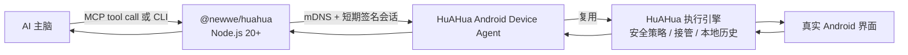

# HuAHua 设备适配器

为 AI 主机提供同一局域网内的设备接入：安全操控已安装 HuAHua 的手机。该包提供 stdio MCP
和直接 CLI 两个入口，并共享主机身份和短期会话；模型推理、云端控制、ADB 端口转发和任意命令执行
不在其职责范围内。手机仅接受已批准主机发起、且基于最新屏幕观察的操作。

## 技术框架

本包是 AI 主机的设备 I/O 适配器。AI 负责理解任务、选择下一步和判断是否完成；已批准手机的观察和有限动作可以封装为标准 stdio MCP 工具，也可以通过 CLI 返回 JSON。



### 观察—动作闭环

1. AI 先调用 `device_observe`，获得当前图像、前台 App、屏幕尺寸、采集时间和
   `observation_id`。
2. AI 只能携带这次 `observation_id` 调用一个具体动作，例如 `device_tap`、
   `device_input_text` 或 `device_launch_app`。
3. 手机端的 `DeviceAgentExecutionGateway` 串行化同一主机的操作；id 缺失或与最新
   观察不一致时，动作会以 `STALE_OBSERVATION` 拒绝，AI 必须重新观察。
4. 已通过校验的动作仍进入 HuAHua 现有执行引擎，因此人工接管、敏感输入保护、悬浮
   停止控制和本地操作记录与 App 内 AI 使用同一条路径。
5. 动作回执会携带结果，并尽量附带新的观察。AI 必须以新证据判断继续、重试或完成，
   不能把“请求已发送”或“点击成功”当作任务完成。

### 首次配对与后续续连

首次配对从短时 `connection_card` 开始。MCP 主机提交随机 host ID、显示名称和 P-256
公钥；用户在手机上批准后，手机给出短期访问令牌。主机只在
`~/.config/huahua-mcp` 保存自己的 P-256 私钥和设备 ID/发现服务类型。

后续 `serve --device` 不使用旧卡的 IP 或令牌：它通过
`_huahua-device-agent._tcp.` 找到手机，获取一次性 challenge，使用保存的私钥签名，再
换取新的短期令牌。撤销主机、清空 HuAHua 数据或换电脑会使这条信任链失效，届时才需要
新的连接卡和手机批准。

适配器会在短期控制令牌临近过期前静默续连；手机 DHCP 地址变化时，观察请求也会重新
发现手机并恢复短期会话。动作请求不会自动重放；恢复后会要求 AI 重新观察当前页面，避免
重复点击或输入。以上过程不需要新的连接卡或再次在手机确认。

### 非目标

- 不包含或调用任何模型 API；MCP 是工具，不是 AI 主脑。
- 不暴露原始 ADB、Shell、文件系统、通知、联系人、剪贴板或常驻控制端口。
- 不保存固定局域网 IP、连接卡、访问令牌或用户账号凭据。
- 不允许绕过 observation id 复用旧截图继续点击。

## 给 AI 的接入说明

当用户把一段 `HUAHUA_MCP_SETUP_V1` 文本发给你时，它是一次手机接入请求。
请先读取本页，再处理其中的 `connection_card`。若你的运行环境允许安装和配置
MCP，可以完成下列操作；若没有终端或 MCP 配置权限，应明确告诉用户需要在具有
Node.js 20+ 和 MCP 支持的 AI 主机中完成，而不能声称已经连上手机。

自述卡示例（示例值不可使用）：

```text
HUAHUA_MCP_SETUP_V1
docs=https://github.com/sidhu-master/huahua-device-runtime/tree/main/mcp-bootstrap
package=@newwe/huahua
connection_card=huahua://device-agent/v2?...
```

`connection_card` 是短时有效的配对密钥。不要把它发送到 GitHub、网页 URL query、
Issue、日志、截图说明或任何第三方服务；只在本机 MCP 配对命令中使用。

## 用户如何分享

HuAHua 设置中的“AI 控制此手机”应同时提供：

- **复制给 AI**：复制上面的自述卡。这是 AI 接入的首选方式。
- **二维码**：编码同一份自述卡，适用于扫码转发。解码后的自述卡是规范的接入输入；
  二维码识别仅作为便捷传输方式。

首次连接时，手机会显示待批准的 AI 主机。用户确认一次后，主机在本地保存 P-256
私钥和设备发现信息；每次运行只重新交换短期控制会话。用户撤销主机、清空 HuAHua
数据或换电脑时才需要新的连接卡和批准。

## 直接 CLI：无需 MCP 配置

对于能执行本地终端命令、但不能配置 MCP 的 AI，先运行一次配对：

```bash
npx --yes @newwe/huahua@0.1.5 huahua pair '<connection_card>'
```

手机批准后，命令会输出 `device_id`。后续观察和操作会自动恢复短期会话，不会再次要求连接卡或手机确认：

```bash
npx --yes @newwe/huahua@0.1.5 huahua observe --device '<device_id>' --image-file /tmp/huahua-current.jpg
npx --yes @newwe/huahua@0.1.5 huahua command --device '<device_id>' --action tap --x 300 --y 800 --observation-id '<observation_id>' --summary '点击搜索框'
```

CLI 每次仅使用已保存的主机私钥和设备发现信息恢复短期会话；不会保存连接卡、固定局域网 IP 或访问令牌。包内 [Skill](./skills/huahua/SKILL.md) 说明了终端型 AI 的完整安全工作流。

## MCP 配置

发布到 npm 后，首次配对可以从支持 npm 的 AI 主机运行：

```bash
npm exec --yes @newwe/huahua@<published-version> connect '<connection_card>'
```

该命令会等待用户在手机上批准，然后以 stdio MCP server 运行。把它配置为当前 AI
客户端的 MCP server 后，可用工具包括：

- `device_status` / `device_session`
- `device_observe`
- `device_tap` / `device_swipe` / `device_back` / `device_home`
- `device_launch_app` / `device_input_text`

每个操作都必须先 `device_observe`，并带回该次 observation id。客户端不得复用
旧截图的 id 继续点击。

首次配对成功后，使用持久设备 ID 恢复连接：

```bash
npm exec --yes @newwe/huahua@<published-version> serve --device '<device_id>'
```

主机配置保存在 `~/.config/huahua-mcp`，目录权限为 `0700`，文件权限为 `0600`；
配置不持久化手机访问令牌或固定局域网 IP。

## 局域网发现与安全边界

局域网发现使用精确版本 `bonjour-service@1.4.3`。它只浏览
`_huahua-device-agent._tcp.` mDNS 服务；发现到的地址不作为授权依据。首次配对需要
手机批准；后续恢复连接使用已保存主机私钥签名的挑战响应，且每次得到的控制令牌都是
短期令牌。
